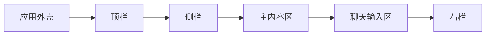

# 界面指引 · 框架高亮（Snow App 脚本插件）

一个注入 Snow 桌面窗口的客户端 UI 脚本：**首次加载时自动对界面框架做一次高亮巡览**——用框形描边把每个区域框出来，旁边配一张说明卡，卡片上同时给出该区域对应的 `data-snow-anchor` 锚点与 `data-snow-slot` 插槽名，看完即散，不再打扰。

- 形态：客户端脚本插件（单文件 `.user.js`），不是面板插件
- 触发：**一次**（装好后第一次进入界面自动播放），之后可从顶栏「指引」按钮或脚本菜单命令重播
- 特点：框形描边 + 说明卡，卡片上的锚点/插槽名**点击即复制**，方便写插件时直接用

## 它做什么

在窗口上盖一层遮罩，只把当前区域留亮，并画一圈描边：



| 步骤 | 框住的区域 | 锚点 / 插槽 | 说明 |
| --- | --- | --- | --- |
| 1 | 应用外壳 | `app.root` | 整个窗口外壳，下面各区域的容器 |
| 2 | 顶栏 | `topbar` / `topbar.actions` | 项目切换、全局搜索、主题与窗口控制；插件按钮挂这里 |
| 3 | 侧栏 | `sidebar.nav` / `sidebar.footer` | 功能入口与底部设置 / 账户区 |
| 4 | 主内容区 | `main.view` + `data-snow-view` | 当前视图主体，`@snow-view` 按它匹配 |
| 5 | 聊天输入区 | `chat.input` / `chat.input.actions` | 输入、模型、附件；插件可追加按钮 |
| 6 | 右栏 | `rightPanel` / `rightPanel.content` | 文件 / 终端 / 变更等标签页，可收起 |

区域不存在或已收起（比如不在聊天视图、右栏被折叠）时会**自动跳过**那一步；巡览过程中切换视图导致当前区域消失，也会自动跳到下一个仍然存在的区域。

## 交互

| 操作 | 效果 |
| --- | --- |
| `Enter` / `→` / 空格 / 点击暗区 | 下一步（最后一步为完成） |
| `←` | 上一步 |
| `Esc` / 卡片上的「跳过指引」 | 结束本次巡览（同样记为看过） |
| 点击卡片里的锚点标签 | 复制该锚点 / 插槽名（如 `data-snow-anchor="topbar"`） |
| 顶栏「指引」按钮 / 脚本菜单命令 | 随时重播 |

框形描边与说明卡会**逐帧跟随真实布局**，拖动窗口、折叠侧栏、切换视图都不会跑偏。

## 在插件市场里找到它

本仓库带 GitHub 主题 [`snow-plugins`](https://github.com/topics/snow-plugins)，**插件市场 → 社区插件** 打开即可搜到本仓库（关键词：`界面指引`、`ui-guide`、`snow-app-plugins`）。注意社区通道只安装仓库根目录含 `plugin.json` 的面板插件，脚本请用下面的方式安装。

## 安装

### 方式一：插件页面导入

插件 → 插件列表 → 脚本插件 → **导入文件**，选择 `ui-guide.user.js`，保存即生效。

### 方式二：命令行 / 让 AI 安装

```text
config-set scope=userscripts key="new" value={sourcePath: "D:/GitHub/snow-app-plugins/plugins/ui-guide/ui-guide.user.js"}
```

安装后可在「插件列表 → 脚本插件」中启停、编辑、删除。

## 数据与隐私

- 只用 `GM_getValue` / `GM_setValue` 保存一个标记（`uig.seen.v1` = 是否已看过），决定要不要自动播放。
- **不读取任何应用元数据**、不发起任何网络请求，因此没有 `@snow-privacy` 声明。
- 运行在默认的**沙箱档**（独立隔离世界），只通过 DOM、`GM_*` 与只读的 `snow.context.view` / `snow.slot` 工作；遮罩层不注册任何应用能力。
- 遮罩层是临时节点，巡览结束（或脚本停用）即整体移除，不改动界面本身的结构与样式。

## 元数据头

```javascript
// @snow-target  client   → 只注入桌面窗口
// @snow-view    *        → 所有视图
// @snow-scope   global   → 常驻，随视图切换不卸载
// @icon         lucide:SquareDashedMousePointer
```

## 文件结构

```text
plugins/ui-guide/
  ui-guide.user.js   # 全部逻辑与样式（单文件，无需构建）
  README.md
```

## 自定义

| 想改什么 | 改哪里 |
| --- | --- |
| 巡览哪些区域、顺序 | `STEPS`（`anchor` 为 `data-snow-anchor` 值，`tags` 为卡片上展示的标签） |
| 每步文案 | `COPY["zh-CN"]` / `COPY.en` 里的 `step*Title` / `step*Desc` |
| 首次自动播放的延迟 | `AUTO_START_DELAY`（默认 900ms）与 `MAX_WAIT_TRIES`（等界面就绪的上限） |
| 描边留白、圆角 | `BOX_PAD` 与 `CSS` 里的 `.uig-box` |
| 配色 | `CSS` 里的 `#7ff0d4` / `#3fc9b0` 等渐变色 |
| 说明卡尺寸 | `CSS` 里的 `.uig-card{width:...}` |

修改后重新导入或编辑保存即可，脚本会重新注入。

## 注意

- 巡览期间遮罩会**暂时挡住鼠标操作**（键盘与卡片按钮可用），按 `Esc` 或「跳过指引」立即退出。
- 自动播放只在装好后的第一次发生；若那次界面还没就绪（或用户直接跳过），标记仍会写入，需要重播请用顶栏「指引」按钮。
